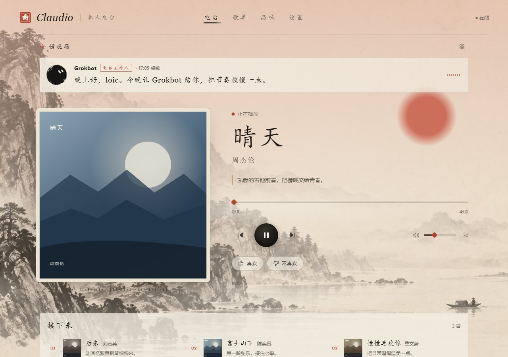
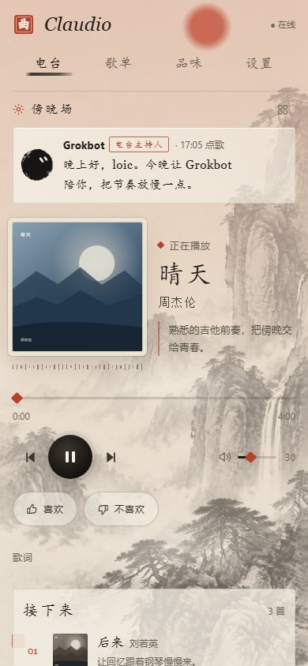

# Claudio

> 一个会读你口味、按时辰换色的私人 AI 电台。

Claudio 是一个本地运行的 AI 电台播放器。外部 DJ Bot（或内置的 Claude）决定放什么，Claudio 负责在酷狗音乐里检索、解析直链、维护队列，并在浏览器 PWA 里播放。界面是宣纸水墨风，配色随时辰变化。

**English overview** — Claudio is a self-hosted AI radio player. A host bot (or Claude in `internal` mode) picks tracks over HTTP; Claudio resolves them through a local [KuGouMusicApi](https://github.com/MakcRe/KuGouMusicApi) instance and plays them in a water-ink styled PWA. It runs on Node.js, stores state in SQLite, and binds to localhost by default.

| 桌面 | 手机 |
| --- | --- |
|  |  |

## 特性

- **主持人与播放器分离**：外部 Bot 通过 HTTP 点歌，Claudio 只做检索、直链和播放，不把选歌逻辑绑死在播放器里。
- **酷狗音乐集成**：搜索、打分、播放直链、歌词、歌单读取与写入。
- **水墨 PWA**：宣纸底、山水背景、按时辰换色；支持歌词、媒体键、音量记忆、队列和续播池。
- **本地优先**：默认只监听 `127.0.0.1`；令牌、Host 白名单、音频代理域名白名单都在默认配置里。
- **两种选歌模式**：`external`（默认，外部 Bot）和 `internal`（Claude / DeepSeek 结合口味、时间、天气、历史选歌）。
- **依赖克制**：原生 ESM、无前端框架，SQLite 使用 Node 内置的 `node:sqlite`。

## 架构

```text
外部 DJ Bot ──HTTP──┐
                    ▼
              Claudio (Node / Express + WebSocket)
                    │
      ┌─────────────┼──────────────┐
      ▼             ▼              ▼
 KuGouMusicApi   state.db       PWA (浏览器)
  酷狗检索/直链    SQLite        <audio> 播放
```

## 快速开始

### 前置要求

- Node.js >= 22.12
- 一个可用的 KuGouMusicApi 上游（社区 fork，单独部署）
- 酷狗账号（可选；匿名也能搜到一部分歌）

### 1. 克隆并安装

```bash
git clone https://github.com/Guzi212/Claudio.git
cd Claudio
npm ci
```

### 2. 准备 KuGouMusicApi

默认从 Claudio 同级的 `../KuGouMusicApi` 启动上游：

```bash
git clone https://github.com/MakcRe/KuGouMusicApi.git ../KuGouMusicApi
cd ../KuGouMusicApi
npm install
cd ../Claudio
```

`npm run dev` 会把上游端口设为 `33400`。不用默认的 3000，是因为 Windows 开着 Hyper-V / WSL / Docker 时常把 3000 附近划进排除端口，非管理员启动会报 `EACCES`。目录或端口不同时，在 `.env` 里改 `KUGOU_API_DIR` / `KUGOU_API_BASE`。

> 不同 fork 的接口路径会有差异。搜歌返回 404 时，去 `server/services/kugou.js` 顶部的 `ENDPOINTS` / `LOGIN_PATH` 改路径。

### 3. 配置

```bash
cp .env.example .env
```

至少填一项酷狗凭证：

- `KUGOU_USERNAME` / `KUGOU_PASSWORD`（推荐，自动登录）
- 或 `KUGOU_COOKIE`（从浏览器抓 cookie）

要给另一台机器上的 Bot 调用时，再设置 `CLAUDIO_API_TOKEN`，并阅读 [监听地址与鉴权](docs/manual.md)。

### 4. 填入你的口味（可选）

仓库里的 `user/taste.md` 和 `user/routines.md` 是模板。推荐复制成 `.local.md` 再改，这样不会被 git 跟踪：

```bash
cp user/taste.md user/taste.local.md
cp user/routines.md user/routines.local.md
```

Claudio 会优先读 `.local` 文件。也可以直接改模板文件，但提交时注意不要把个人内容带进仓库。

### 5. 运行

```bash
npm run dev
```

看到 `[claudio] 8080 ready` 后打开 <http://127.0.0.1:8080>。

只想调试 Claudio 本体、不启动上游：

```bash
npm run dev:app
```

## 两种模式

### external（默认）

- 不调用 Claude，不开机选歌，不定时推歌。
- 队列由外部 Bot 通过 `POST /api/queue/external` 投递。
- 队列播完后从主持人设置的续播池继续；没有续播池就停。
- 不需要安装 Claude Code CLI。

```bash
curl -X POST http://127.0.0.1:8080/api/queue/external \
  -H 'Content-Type: application/json' \
  -d '{"tracks":[{"title":"晴天","artist":"周杰伦"}],"say":"今晚先听这轮","mode":"replace"}'
```

### internal

把 `.env` 里的 `CLAUDIO_BRAIN` 改成 `internal`，并保证本机能跑 `claude -p`，或配置 `DEEPSEEK_API_KEY`。恢复开机电台、聊天点歌、定时推歌和按时间/天气/历史选歌。

完整接口、字段和 PowerShell 示例见 [docs/manual.md](docs/manual.md)。

## 配置与安全

完整环境变量说明在 [`.env.example`](.env.example)。几个关键项：

| 变量 | 默认 | 说明 |
| --- | --- | --- |
| `CLAUDIO_BRAIN` | `external` | `external` 外部 Bot 选歌；`internal` 由 Claude / DeepSeek 选歌 |
| `CLAUDIO_HOST` | `127.0.0.1` | 监听地址。改成 `0.0.0.0` 前先设置令牌 |
| `CLAUDIO_API_TOKEN` | 空 | 非回环请求的令牌；留空时拒绝一切非本机请求 |
| `CLAUDIO_REQUIRE_TOKEN` | 关 | 打开后连本机也必须带令牌 |
| `CLAUDIO_ALLOWED_HOSTS` | 空 | 局域网 IP / 穿透域名的 Host 白名单 |
| `KUGOU_API_BASE` | `http://localhost:33400` | KuGouMusicApi 地址 |
| `KUGOU_PROXY` | 空 | Clash 等本地代理端口，仅酷狗出站使用 |

默认只监听回环；`/api/*`、`/tts/*` 和 WebSocket 对非回环来源要求令牌。音频代理只转发 `kugou.com` / `kgimg.com` 及其子域。细节见 [docs/manual.md](docs/manual.md)。

## 开发

```bash
npm test
```

UI 视觉验收（需要本机 Chrome）：

```bash
node scripts/verify-radio-ui.mjs <输出目录>
```

- 改了 PWA 壳资源（HTML / CSS / JS / 图片）要升 `pwa/sw.js` 的 `CACHE` 版本，并同步测试里的版本断言。
- 分支、worktree、提交和 PR 约定见 [CONTRIBUTING.md](CONTRIBUTING.md)。

## 目录

```text
server/     Node 后端：Express、WebSocket、酷狗服务、鉴权、SQLite
pwa/        PWA：播放页、歌单、品味、设置、歌词、水墨资源
prompts/    DJ 人格与 JSON schema 约束
user/       口味与日程模板（个人覆盖写 *.local.md）
claudio/    人格设定与关系日志模板（个人日志写 journal.local.md）
docs/       完整使用手册、截图
tests/      vitest
scripts/    开发启动、酷狗导入、全局热键、UI 视觉验收
```

## 常见问题

- **搜歌 404**：上游 fork 的接口路径不同，改 `server/services/kugou.js` 顶部的 `ENDPOINTS` / `LOGIN_PATH`。
- **端口 `EACCES`**：换一个不在 Windows 排除端口段里的端口，默认 `33400`。
- **Clash 开着时酷狗连不上**：在 `.env` 里设置 `KUGOU_PROXY=http://127.0.0.1:7890`，或把酷狗域名设为直连。
- **匹配不到的歌**：会写入 `state.db` 的 `unmatched` 表，方便回头调整口味语料或搜索策略。
- **接口 401 / 403**：检查 `CLAUDIO_API_TOKEN`、`CLAUDIO_REQUIRE_TOKEN` 和 `CLAUDIO_ALLOWED_HOSTS`。

## 免责声明

Claudio 通过社区维护的 KuGouMusicApi 访问酷狗音乐，与酷狗官方无关。请仅用于个人学习和自用，遵守酷狗的服务条款和当地版权法规；不要用本项目批量抓取、分发或商业利用受版权保护的音乐。项目按 MIT 许可“按原样”提供，不附带任何担保。

## License

[MIT](LICENSE)
